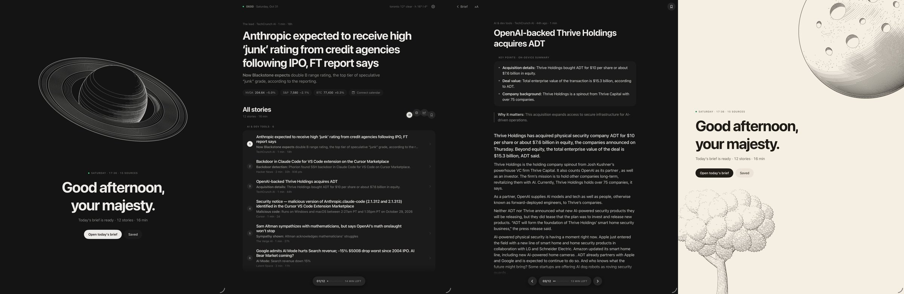

# 0600

A calm daily brief for iPad. Each morning 0600 reads the sources you follow, picks the 12 or so stories worth your time and fits them into a 15-minute read. Every story gets a short summary written on the device itself, so nothing about what you read leaves your iPad.

## Features

- **Good morning, your majesty.** A quiet opening screen with an engraving that changes daily, then one tap to build or open today's brief.
- **One brief a day.** Ranked, deduplicated stories from AI, developer tools, startups and venture sources, with stories never repeating on later days.
- **On-device summaries.** Three key points with bold leads and a one-line "why it matters", written privately by Apple Intelligence.
- **A reader that's just the text.** A clean centred column, adjustable text size, and a floating progress pill to move between stories.
- **Markets, weather and calendar** at a glance on the home screen.
- **Themes:** Dark, Warm, Cream, or Auto to follow your iPad.
- **Saved stories** with their summary and full text, and a gentle 6 AM notification when the brief is ready.

## Availability

0600 is not on the App Store yet. Follow this repository for the first release.

Requires iPadOS 27 and an iPad with Apple Intelligence for on-device summaries.

## License

0600 is proprietary software. The source code is not published. See [LICENSE](LICENSE).
